# Ensemble report: vanilla115_1836_1936_all

Generated 2026-11-05 by `tools/ensembles/Make-EnsembleReport.py` from `tools/ensembles/ensembles.sqlite`. 10 members, 1836-01-02 to 1856-01-01, quarterly; game 1.15.0.

Charts: line = median of members, band = 10th–90th percentile, faint lines = individual members. cv = sd / mean across members. MDE = minimum detectable effect: the smallest true difference a two-sided test (α = 0.05) catches with 80% power when comparing two ensembles of this size; shown as % of the mean.

## Key findings

- World GDP grows +87.7% over 20 years (member spread 2.1% cv); pop-weighted SoL falls 9.02 → 8.19 and unemployment goes ×4.4 (7.33 M → 32.3 M): the world gets richer in total and poorer per head.
- With 10 vs 10 members the minimum detectable effect is 3%–5% for world GDP, SoL, infrastructure usage, urban centers and ranches; 10%–39% for unemployment, construction and gold; 9%–35% for deficit states and railways. Wars are untestable (MDE 89%). Clamped prices (transport) look precise only because they can't move.
- Power trajectories differ a lot in predictability: GDP cv at the end is lowest for GBR, FRA, RUS, SIA and highest for PAN, NET, BEL, AUS. The GDP top five is the same set of countries in 7/10 members, and in exactly the order CHI > GBR > FRA > RUS > USA in 3/10.
- Infrastructure is slack in aggregate (world utilization 36% → 45%) but shortages spread: states with usage > supply go 8.67 → 45.4 (cv 26.5%). Railways grow 18 → 235 levels with ~7% spread, the noisiest infrastructure metric.
- Industrialisation squeezes inputs: the biggest world price rises are engines +73%, glass +51%, explosives +45%, ammunition +43%, iron +35%; plantation goods glut (tea -47%, sugar -44%, coffee -37%, tobacco -25%).
- Transportation is the standout shortage good for BOI: world supply covers only 12% of demand at the start and 34% at the end, and 99% → 71% of transport demand sits in markets pinned at the price ceiling (1.75 × base). The world price can't register the shortage; watch orders and the at-ceiling share instead.

Contents: [Setup](#setup) · [World](#world) · [Noise and power](#noise-and-power) · [Great powers](#great-powers) · [Geopolitics](#geopolitics) · [Infrastructure](#infrastructure) · [Markets](#markets) · [Construction and urbanization](#construction-and-urbanization) · [Fiscal](#fiscal) · [BOI cheat-sheet](#boi-cheat-sheet) · [Appendix](#appendix)

## Setup

**vanilla: `vanilla115_1836_1936_all`** (control). Every 1.15.0 game of the vanilla115_1836_1936 batch, including the 5 that crashed (in 1872, 1896, 1928, 1886 and 1899), each up to its last complete snapshot. Four crashes hit the same address in the snapshot's state loop and look unrelated to how the game develops, so the partial games add members past 1886. The 1899 game uses snapshot version 4, which starts in April 1836.

| item | value |
|:--|--:|
| members | 10 |
| snapshots per member | 81–81 of 81 (none dropped) |
| minutes per member | 21.9–142.2 (total 9.7 h) |
| game version | 1.15.0 |
| DLC installed / disabled | 18 / 0 |
| mods | none (telemetry only) |
| telemetry modules | core, parity, ensemble |

Countries are keyed by engine id; civil-war revolutionaries share their parent's tag, so the second country under a tag in a member is labelled `TAG#2` (see `run_country`).

## World

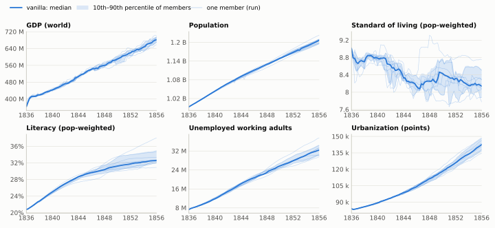

| metric | 1836-01 | 1856-01 mean | growth | sd | cv | MDE (n=10 vs 10) |
|:--|--:|--:|--:|--:|--:|--:|
| GDP (world) | 363 M | 682 M | +87.7% | 14.1 M | 2.1% | 2.7% |
| Population | 993 M | 1.2 B | +21.3% | 8.77 M | 0.7% | 1.0% |
| Standard of living (pop-weighted) | 9.02 | 8.19 | -9.2% | 0.288 | 3.5% | 4.7% |
| Literacy (pop-weighted) | 20.8% | 33.1% | – | 2.0% | 6.0% | 7.9% |
| Unemployed working adults | 7.33 M | 32.3 M | +341.0% | 2.43 M | 7.5% | 10.0% |
| Urbanization (points) | 84.1 k | 142 k | +69.1% | 4.69 k | 3.3% | 4.4% |
| Countries alive | 291 | 242 | -16.7% | 6.88 | 2.8% | 3.8% |
| Wage (pop-weighted, /yr) | 0.435 | 0.665 | +53.0% | 0.029 | 4.3% | 5.8% |
| Radicals | 14.5 M | 109 M | +654.4% | 16.2 M | 14.8% | 19.7% |
| Loyalists | 0 | 37.6 M | – | 4.6 M | 12.2% | 16.2% |
| State turmoil (pop-weighted) | 1.5% | 9.1% | – | 1.4% | 14.9% | 19.8% |

CHI averages 33% of world population, so pop-weighted world SoL largely tracks it. The biggest one-quarter jump in any member (member 6, 1836-04 → 1836-07: 8.82 → 8.21) is CHI's SoL going 8.68 → 7.08. Compare SoL per country, or the powers' SoL panels, when testing welfare effects.

GDP rises +49.2% in the first half and +25.8% in the second (front-loaded). Population is nearly deterministic (cv 0.7%); welfare measures (SoL, unemployment, wage) carry 2–5% noise.

## Noise and power

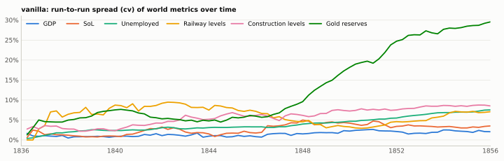

*Spread starts at zero (identical start) and grows; most world metrics settle at 1–6% within a few years, railways near 10%.*

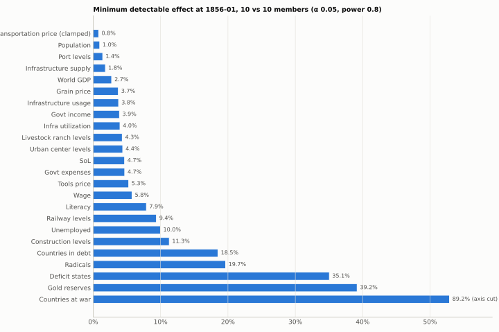

| metric | cv | MDE n=10 | n for 1% | n for 2% | n for 5% | n for 10% |
|:--|--:|--:|--:|--:|--:|--:|
| Transportation price (clamped) | 0.6% | 0.8% | 8 | 3 | 3 | 3 |
| Population | 0.7% | 1.0% | 10 | 4 | 3 | 3 |
| Port levels | 1.1% | 1.4% | 19 | 6 | 3 | 3 |
| Infrastructure supply | 1.4% | 1.8% | 31 | 9 | 3 | 3 |
| World GDP | 2.1% | 2.7% | 68 | 18 | 4 | 3 |
| Grain price | 2.8% | 3.7% | 126 | 33 | 7 | 3 |
| Infrastructure usage | 2.8% | 3.8% | 128 | 33 | 7 | 3 |
| Govt income | 2.9% | 3.9% | 137 | 35 | 7 | 3 |
| Infra utilization | 3.0% | 4.0% | 143 | 37 | 7 | 3 |
| Livestock ranch levels | 3.3% | 4.3% | 168 | 43 | 8 | 3 |
| Urban center levels | 3.3% | 4.4% | 173 | 44 | 8 | 4 |
| SoL | 3.5% | 4.7% | 195 | 50 | 9 | 4 |
| Govt expenses | 3.5% | 4.7% | 197 | 50 | 9 | 4 |
| Tools price | 4.0% | 5.3% | 250 | 64 | 11 | 4 |
| Wage | 4.3% | 5.8% | 298 | 76 | 13 | 5 |
| Literacy | 6.0% | 7.9% | 559 | 141 | 24 | 7 |
| Railway levels | 7.1% | 9.4% | 788 | 198 | 33 | 9 |
| Unemployed | 7.5% | 10.0% | 891 | 224 | 37 | 10 |
| Construction levels | 8.5% | 11.3% | >1000 | 286 | 47 | 13 |
| Countries in debt | 14.0% | 18.5% | >1000 | 768 | 124 | 32 |
| Radicals | 14.8% | 19.7% | >1000 | 865 | 140 | 36 |
| Deficit states | 26.5% | 35.1% | >1000 | >1000 | 441 | 111 |
| Gold reserves | 29.6% | 39.2% | >1000 | >1000 | 550 | 139 |
| Countries at war | 67.3% | 89.2% | >1000 | >1000 | >1000 | 713 |

n = members per arm needed to detect a true change of that size (two-sample, α 0.05, power 0.8), assuming the mod leaves the spread unchanged.

### Regimes: revolution waves

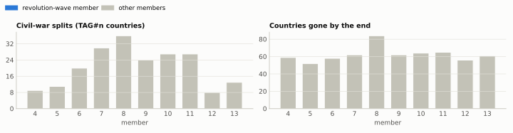

## Great powers

The 17 countries at rank ≥ 5 (great, major, unrecognized major) at the start, ordered by median GDP at 1856-01. Independent y-axes.

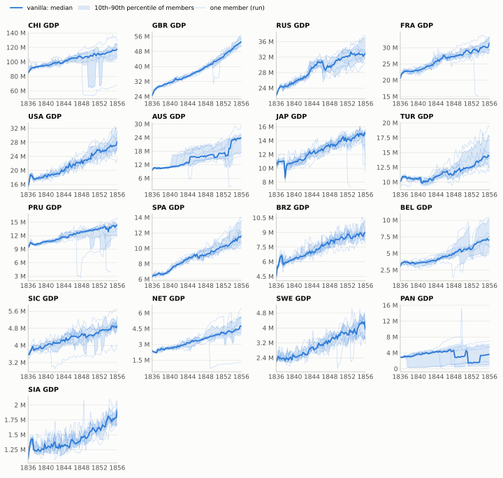

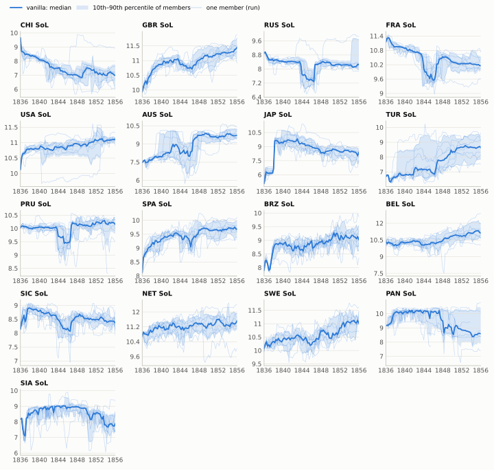

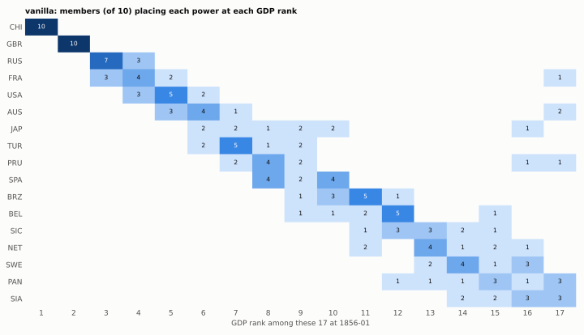

| power | GDP (median) | growth | GDP cv | SoL | railways | techs | time at war | great power at end |
|:--|--:|--:|--:|--:|--:|--:|--:|--:|
| CHI | 118 M | +39.0% | 15.1% | 6.98 | 0 | 40 | 12% | 0/10 |
| GBR | 53.2 M | +116.8% | 3.4% | 11.4 | 55 | 75 | 39% | 10/10 |
| RUS | 33 M | +49.4% | 6.4% | 8.24 | 1 | 51 | 21% | 10/10 |
| FRA | 31.4 M | +52.5% | 6.3% | 10.2 | 16 | 69 | 15% | 9/10 |
| USA | 28.3 M | +82.7% | 8.1% | 11.1 | 23.5 | 73 | 11% | 10/10 |
| AUS | 23.8 M | +148.7% | 18.7% | 9.71 | 13 | 65 | 12% | 7/10 |
| JAP | 15.2 M | +40.1% | 16.3% | 8.39 | 0 | 48 | 1% | 0/10 |
| TUR | 14.5 M | +42.2% | 15.0% | 8.65 | 0 | 43 | 19% | 3/10 |
| PRU | 14.4 M | +52.3% | 10.4% | 10.2 | 16 | 70 | 9% | 5/10 |
| SPA | 11.6 M | +84.6% | 10.0% | 9.68 | 5 | 54 | 18% | 8/10 |
| BRZ | 8.97 M | +100.6% | 8.9% | 9.02 | 0.5 | 52 | 12% | 0/10 |
| BEL | 7.01 M | +127.1% | 26.7% | 11.1 | 5 | 74 | 4% | 0/10 |
| SIC | 4.91 M | +36.5% | 8.7% | 8.38 | 0 | 50 | 5% | 0/10 |
| NET | 4.72 M | +95.6% | 29.3% | 11.5 | 5 | 68 | 10% | 1/10 |
| SWE | 3.92 M | +78.9% | 12.7% | 11 | 4 | 67 | 2% | 0/10 |
| PAN | 3.61 M | +19.9% | 77.5% | 8.59 | 0 | 40 | 10% | 0/10 |
| SIA | 1.9 M | +73.9% | 7.1% | 7.88 | 0 | 37.5 | 8% | 0/10 |

## Geopolitics

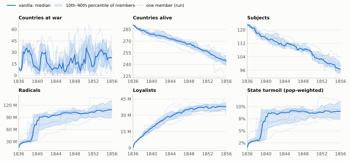

Countries at war swings between 0 and 66 at any snapshot; the quarter-to-quarter series is dominated by individual wars, so treat it as a regime indicator, not a metric.

| event | countries (members out of 10) |
|:--|--:|
| annexed/gone in every member | BGM, LUX, MNP, MOD, NBS, SEQ, SIN |
| gone in at least half | BTN (9), CON (9), KAL (9), QUE (9), SAS (9), SUL (9), TKI (9), WAS (9), AIT (8), EZO (8), HUN (8), JAI (8), KAS (8), KUT (8), ONT (8), QWR (8), BNY (7), BRA (7), HAM (7), HAN (7), KOK (7), KOT (7), MAI (7), NAG (7), NAS (7), SHS (7), TAS (7), TUG (7), WLG (7), BAD (6), BAV (6), BRG (6), HBC (6), HDY (6), ISQ (6), KFA (6), MAH (6), MAK (6), NSW (6), PAN (6), PLP (6), POR (6), SAK (6), SHW (6), SWI (6), AUS (5), AWA (5), BAS (5), BKH (5), BRD (5), BRE (5), CHT (5), COB (5), HAR (5), HAU (5), HEK (5), KAB (5), KHI (5), KNO (5), KRA (5), LIP (5), MEI (5), MEW (5), MST (5), MYB (5), PHL (5), PRG (5), PRU (5), SCM (5), SDM (5), STG (5), SUR (5), TGR (5), TRA (5), WLT (5), WUR (5) |
| formed (new tag) during the run | GUA (13), HON (13), NAL (13), ALT (12), COS (12), NIC (12), DOM (11), D00 (8), D01 (7), ZAN (7), D02 (6), D03 (6), LIM (6), D04 (5), D05 (5), TPG (5), KPR (4), BHT (3), RSM (3), AGJ (2), ASA (2), BUL (2), CAR (2), D06 (2), D07 (2), D08 (2), D14 (2), D15 (2), D16 (2), GAL (2), LAT (2), LOM (2), SUD (2), UKR (2), VEN (2), ABK (1), ABU (1), ACE (1), AGC (1), AIT (1), ALD (1), ALK (1), ALW (1), ANH (1), ANK (1), ARB (1), ARG (1), ARS (1), ASH (1), ASM (1), ATL (1), AUS (1), AWA (1), AWS (1), AZB (1), BAD (1), BAG (1), BAL (1), BAS (1), BAV (1), BCE (1), BEL (1), BEN (1), BER (1), BGI (1), BGL (1), BGM (1), BHN (1), BHO (1), BHU (1), BHV (1), BHW (1), BIC (1), BIK (1), BKH (1), BLG (1), BLH (1), BNJ (1), BNY (1), BOL (1), BOR (1), BOS (1), BRA (1), BRD (1), BRE (1), BRG (1), BRU (1), BRZ (1), BST (1), BTN (1), BUG (1), BUK (1), BUN (1), BUR (1), BYE (1), CAM (1), CHC (1), CHI (1), CHL (1), CHP (1), CHT (1), CIR (1), CLM (1), CMI (1), COB (1), COC (1), CON (1), COO (1), CRO (1), CUB (1), D09 (1), D10 (1), D11 (1), D12 (1), D13 (1), D17 (1), DAH (1), DAI (1), DEI (1), DEN (1), DFR (1), DHA (1), DIR (1), ECU (1), EGY (1), ELS (1), ETH (1), EZO (1), FIN (1), FRA (1), FRM (1), FTJ (1), FTR (1), FZN (1), GAR (1), GBR (1), GJM (1), GLD (1), GRE (1), GUJ (1), GWA (1), GZA (1), HAI (1), HAM (1), HAN (1), HAR (1), HAU (1), HAW (1), HBC (1), HDJ (1), HDY (1), HEK (1), HER (1), HES (1), HOH (1), HOL (1), HUN (1), HYD (1), IBL (1), IDA (1), IND (1), ION (1), IQU (1), ISQ (1), ITA (1), JAB (1), JAI (1), JAP (1), JAS (1), JEY (1), JHN (1), JMB (1), JOD (1), JOH (1), JUN (1), KAB (1), KAF (1), KAL (1), KAN (1), KAS (1), KAT (1), KAU (1), KAZ (1), KFA (1), KHI (1), KHP (1), KLT (1), KNO (1), KOK (1), KON (1), KOR (1), KOT (1), KRA (1), KRG (1), KRN (1), KRT (1), KTI (1), KUN (1), KUT (1), KZH (1), LAH (1), LAN (1), LAO (1), LIB (1), LIP (1), LIT (1), LUA (1), LUB (1), LUC (1), LUX (1), MAD (1), MAH (1), MAI (1), MAK (1), MAS (1), MBS (1), MEC (1), MEI (1), MEW (1), MEX (1), MGD (1), MJT (1), MKT (1), MLD (1), MNL (1), MNP (1), MOD (1), MOL (1), MON (1), MOR (1), MSN (1), MST (1), MUG (1), MYB (1), MYS (1), NAG (1), NAR (1), NAS (1), NAW (1), NBS (1), NEJ (1), NEP (1), NET (1), NOR (1), NPU (1), NSW (1), NVS (1), OLD (1), OMA (1), ONT (1), ORA (1), ORG (1), OYO (1), OZH (1), PAN (1), PAP (1), PAR (1), PBC (1), PCO (1), PER (1), PEU (1), PHI (1), PHL (1), PLP (1), PLY (1), PNI (1), POL (1), PON (1), POR (1), PRA (1), PRG (1), PRK (1), PRM (1), PRU (1), PTA (1), PTN (1), PUD (1), QUE (1), QWR (1), RAJ (1), ROM (1), RUS (1), RWD (1), RYU (1), SAF (1), SAK (1), SAR (1), SAS (1), SAT (1), SAX (1), SCH (1), SCM (1), SCW (1), SDM (1), SEL (1), SEQ (1), SER (1), SGU (1), SHS (1), SHW (1), SIA (1), SIC (1), SIK (1), SIL (1), SIN (1), SLO (1), SMB (1), SNA (1), SOK (1), SPA (1), SPC (1), SPU (1), SRK (1), STG (1), SUL (1), SUR (1), SVN (1), SWE (1), SWI (1), SWT (1), SWZ (1), TAS (1), TEX (1), TGI (1), TGR (1), TIB (1), TID (1), TJI (1), TKI (1), TRA (1), TRH (1), TRI (1), TRN (1), TRS (1), TUG (1), TUN (1), TUR (1), TUS (1), TWT (1), UBD (1), UCA (1), ULR (1), UNT (1), URU (1), USA (1), UYA (1), UZB (1), UZH (1), VNZ (1), WAD (1), WAL (1), WAS (1), WBL (1), WEI (1), WLD (1), WLG (1), WLT (1), WSG (1), WTU (1), WUR (1), YEM (1), YOG (1), YUG (1), ZAI (1), ZUL (1) |
| civil-war split (TAG#n) | AGC (12), AUS (7), HUN (7), JAP (7), KAT (7), MEC (7), POR (7), QUE (7), SAS (7), SIA (7), WTU (7), ALT (6), BEL (6), GRE (6), HAN (6), LAH (6), NEP (6), NSW (6), PER (6), TGI (6), ACE (5), BCE (5), BHN (5), BRA (5), DAI (5), HAM (5), HES (5), LUA (5), LUX (5), MAH (5), MST (5), NAL (5), NAS (5), ONT (5), PRU (5), SAF (5), SAR (5), SHS (5), SWE (5), WLT (5), ANH (4), BTN (4), FRA (4), HAI (4), KRA (4), KTI (4), MEI (4), NET (4), PAR (4), POL (4), PRK (4), STG (4), SWI (4), UBD (4), ASH (3), BAL (3), BAV (3), BRE (3), BUK (3), CHT (3), CIR (3), COS (3), CRO (3), DEN (3), FIN (3), FTJ (3), FTR (3), HAU (3), HAW (3), HOL (3), JAB (3), KBU (3), LIB (3), MOL (3), MYS (3), OMA (3), PAP (3), PON (3), SAX (3), SER (3), SIN (3), TRI (3), TUN (3), TUR (3), TUS (3), WSG (3), ZUL (3), ABU (2), ALK (2), BAD (2), BEN (2), BOL (2), BRZ (2), BST (2), CAM (2), CAR (2), CMI (2), DEI (2), EGY (2), EWE (2), HAR (2), HEK (2), IND (2), ION (2), JHN (2), JOH (2), KOR (2), KPR (2), MBS (2), MEW (2), NEJ (2), OLD (2), PCO (2), RSM (2), RYU (2), SCH (2), SGU (2), SIC (2), SIL (2), SUL (2), SUR (2), TAS (2), TIB (2), TRN (2), WAS (2), WUR (2), AIN (1), ALW (1), ARB (1), ATB (1), AWA (1), BAG (1), BAS (1), BER (1), BHO (1), BHT (1), BHV (1), BHW (1), BKH (1), BLH (1), BNG (1), BRN (1), BRU (1), BUG (1), BUL (1), BUN (1), BUR (1), CHC (1), CHP (1), COC (1), DAH (1), DHA (1), DIR (1), DLA (1), DOM (1), ECU (1), GAL (1), GUA (1), GZA (1), HBC (1), HDJ (1), HDY (1), HRO (1), IBO (1), IDA (1), ISQ (1), JAI (1), JAS (1), JEY (1), JUN (1), KAL (1), KBA (1), KHI (1), KNK (1), KON (1), KOT (1), KRG (1), KRT (1), LOM (1), MAD (1), MAK (1), MGD (1), MJT (1), MOD (1), MSN (1), MUG (1), MYB (1), NAR (1), NAW (1), NOR (1), OYO (1), PHI (1), PHL (1), PRG (1), PTA (1), PTN (1), RUS (1), RWD (1), SAK (1), SAT (1), SEL (1), SEQ (1), SOK (1), SPA (1), SPC (1), SWT (1), SWZ (1), TID (1), TNG (1), TPG (1), TRA (1), TSW (1), TUA (1), TUG (1), URU (1), UYA (1), VEN (1), VNZ (1), WAL (1), WBL (1), YUG (1), ZAN (1) |

Civil wars that happen in at least 80% of members are background: AGC. 

## Infrastructure

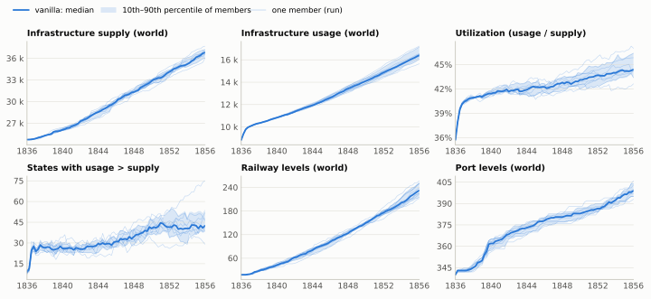

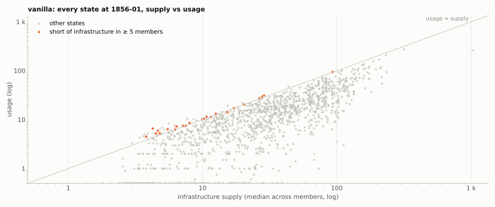

*States with zero usage sit on the bottom edge (log scale).*

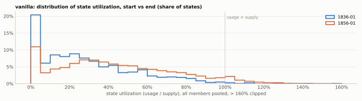

States short of infrastructure in at least half the members at 1856-01 (26 states; median values across members):

| state | owner | short in | supply | usage | shortfall | population |
|:--|--:|--:|--:|--:|--:|--:|
| Kenya | MBS | 10/10 | 4.5 | 5.2 | 0.7 | 33.8 k |
| Tiflis | SVN | 10/10 | 3.8 | 4.5 | 0.7 | 30.2 k |
| Mocambique | AGC | 9/10 | 4.25 | 6.6 | 2.35 | 6.13 k |
| Tiflis | ABK | 9/10 | 6.4 | 7.25 | 0.85 | 86 k |
| North Sumatra | JMB | 9/10 | 8 | 8.55 | 0.55 | 107 k |
| Mocambique | TGI | 8/10 | 4.8 | 5.25 | 0.45 | 23 k |
| East Borneo | BNJ | 7/10 | 10.2 | 10.4 | 0.2 | 164 k |
| Bosnia | TUR | 6/10 | 27.8 | 29.6 | 1.9 | 770 k |
| Kenya | WTU | 6/10 | 4.65 | 5.9 | 1.25 | 21.7 k |
| Beijing | CHI | 6/10 | 93 | 94.2 | 1.2 | 15.6 M |
| Orissa | PTN | 6/9 | 10.7 | 11.5 | 0.8 | 170 k |
| Yemen | MAH | 6/7 | 5.5 | 6.3 | 0.8 | 39.4 k |
| Lima | NPU | 6/8 | 26.5 | 27.2 | 0.7 | 511 k |
| Tahiti | PLY | 6/10 | 12.6 | 13.2 | 0.7 | 179 k |
| Yemen | KAT | 6/10 | 6.25 | 6.5 | 0.25 | 55.2 k |
| Malwa | BHO | 6/9 | 20.4 | 20.4 | 0 | 389 k |
| Transvaal | SWZ | 6/10 | 7.5 | 7.5 | 0 | 100 k |
| Western New Guinea | TID | 6/10 | 11.5 | 11.2 | -0.25 | 145 k |
| Malwa | IND | 5/9 | 28.7 | 31.3 | 2.6 | 578 k |
| Transorangia | PHL | 5/8 | 5.5 | 6.4 | 0.9 | 43.7 k |
| Northern Cape | WBL | 5/8 | 7.15 | 7.5 | 0.35 | 80.5 k |
| Arequipa | NPU | 5/8 | 10.4 | 10.6 | 0.3 | 247 k |
| Kenya | OMA | 5/10 | 9.95 | 10.2 | 0.25 | 217 k |
| West Bengal | COO | 5/9 | 17.1 | 17.1 | 0 | 314 k |
| Ceylon | MLD | 5/10 | 6.25 | 6.25 | 0 | 53.7 k |

Market access is uninformative in vanilla: pop-weighted world market access stays at 99.7% (cv 0.31%). Deficits in vanilla don't yet cut states off; BOI changing that would show up here immediately.

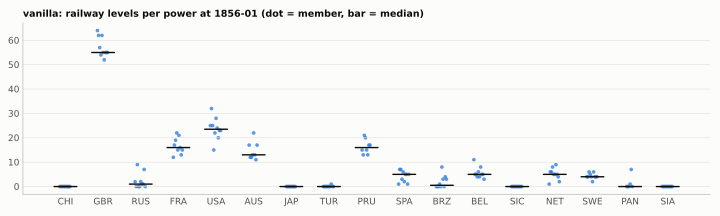

## Markets

World prices are demand-weighted averages over markets (`world_goods`). Index = price / base price; the engine clamps market prices to base × (1 ± 0.75), i.e. index 0.25–1.75.

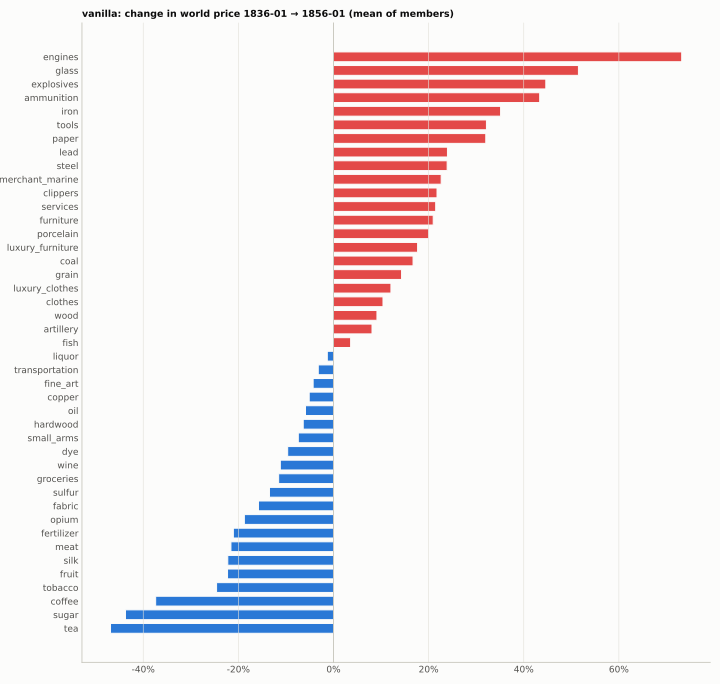

*Red = dearer, blue = cheaper. Goods with negligible world demand are omitted.*

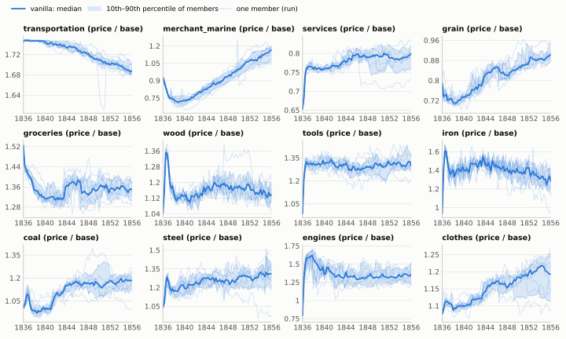

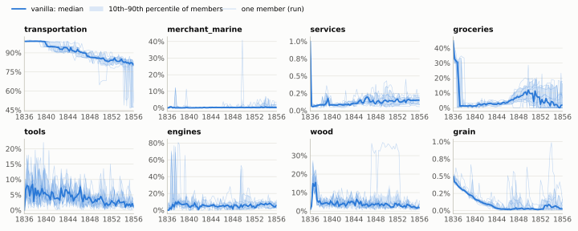

*Share of each good's world demand in markets whose price is at the ceiling (1.75 × base). Independent y-axes.*

A market at the ceiling can't signal a worse shortage through price, so for transport-heavy changes watch this share and the buy/sell orders, not the world price.

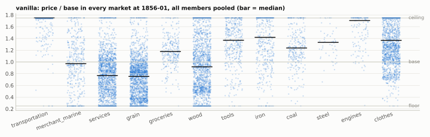

Top 30 goods by world demand at the end:

| goods | price 1836-01 | price 1856-01 | change | price cv | demand/wk | supply/demand | demand at ceiling |
|:--|--:|--:|--:|--:|--:|--:|--:|
| grain | 15.8 | 18.1 | +14.3% | 2.8% | 80.2 k | 1.13 | 0% |
| wood | 20.8 | 22.7 | +9.1% | 4.1% | 67.7 k | 0.89 | 2% |
| fabric | 16.6 | 14 | -15.8% | 4.1% | 44.5 k | 1.42 | 0% |
| services | 19.6 | 23.8 | +21.5% | 3.6% | 37.4 k | 1.28 | 0% |
| clothes | 32.3 | 35.6 | +10.4% | 5.2% | 35.7 k | 0.83 | 3% |
| fruit | 41.8 | 32.5 | -22.3% | 1.5% | 32.9 k | 0.93 | 0% |
| transportation | 52.4 | 50.7 | -3.2% | 0.6% | 28 k | 0.34 | 71% |
| furniture | 30 | 36.3 | +21.0% | 3.4% | 27.7 k | 0.82 | 5% |
| tools | 39.4 | 52.1 | +32.2% | 4.0% | 22 k | 0.73 | 1% |
| meat | 42.8 | 33.6 | -21.6% | 1.9% | 21.9 k | 0.90 | 1% |
| paper | 34.4 | 45.4 | +32.0% | 3.3% | 21.3 k | 0.60 | 8% |
| iron | 37.4 | 50.6 | +35.1% | 11.0% | 18.4 k | 0.79 | 7% |
| fish | 19.1 | 19.7 | +3.6% | 2.1% | 17.1 k | 1.03 | 0% |
| tobacco | 37.5 | 28.3 | -24.6% | 5.3% | 16.6 k | 1.40 | 0% |
| groceries | 45.8 | 40.5 | -11.5% | 2.5% | 15.8 k | 0.71 | 5% |
| coal | 30.2 | 35.2 | +16.7% | 6.3% | 15.4 k | 0.84 | 2% |
| tea | 57.1 | 30.3 | -46.9% | 7.0% | 14 k | 1.58 | 1% |
| opium | 57.9 | 47 | -18.7% | 5.6% | 13.3 k | 1.14 | 0% |
| liquor | 26.5 | 26.1 | -1.3% | 4.0% | 12.9 k | 1.20 | 5% |
| luxury_clothes | 64.5 | 72.3 | +12.1% | 4.6% | 10.1 k | 0.84 | 12% |
| sugar | 33.6 | 18.9 | -43.7% | 9.3% | 8.27 k | 1.58 | 5% |
| silk | 44.8 | 34.9 | -22.2% | 4.5% | 8.15 k | 1.19 | 5% |
| hardwood | 49.6 | 46.4 | -6.4% | 8.5% | 6.23 k | 0.88 | 4% |
| coffee | 60.9 | 38.1 | -37.4% | 6.8% | 5.76 k | 1.39 | 0% |
| clippers | 45 | 54.8 | +21.8% | 3.6% | 5.6 k | 1.14 | 3% |
| small_arms | 69.4 | 64.3 | -7.4% | 4.7% | 5.12 k | 0.97 | 8% |
| steel | 52 | 64.4 | +23.9% | 10.3% | 4.26 k | 0.77 | 0% |
| luxury_furniture | 67.6 | 79.5 | +17.7% | 2.0% | 4.22 k | 0.66 | 23% |
| dye | 19.3 | 17.5 | -9.6% | 11.5% | 4.15 k | 2.42 | 0% |
| merchant_marine | 46.5 | 57 | +22.6% | 5.4% | 3.73 k | 0.94 | 1% |

## Construction and urbanization

Vanilla stand-ins for BOI's housing: urban centers, construction capacity, the industry that competes for it, and ranching (horses come from livestock).

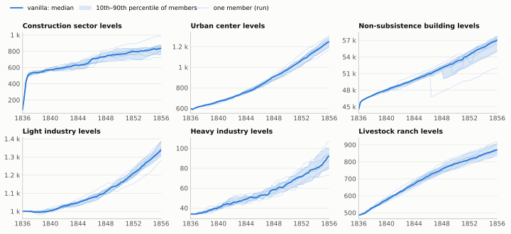

| metric | 1836-01 | 1856-01 mean | growth | sd | cv | MDE (n=10 vs 10) |
|:--|--:|--:|--:|--:|--:|--:|
| Construction sector levels | 83 | 835 | +905.5% | 71.1 | 8.5% | 11.3% |
| Urban center levels | 601 | 1.24 k | +107.0% | 41.1 | 3.3% | 4.4% |
| Non-subsistence building levels | 44.5 k | 56.5 k | +27.0% | 1.71 k | 3.0% | 4.0% |
| Light industry levels | 1 k | 1.34 k | +34.0% | 34.8 | 2.6% | 3.4% |
| Heavy industry levels | 34 | 90.4 | +165.9% | 9.94 | 11.0% | 14.6% |
| Livestock ranch levels | 487 | 875 | +79.6% | 28.5 | 3.3% | 4.3% |
| Urbanization (points) | 84.1 k | 142 k | +69.1% | 4.69 k | 3.3% | 4.4% |

## Fiscal

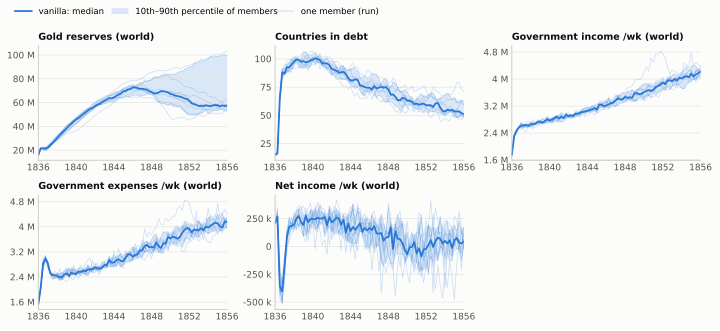

| metric | 1836-01 | 1856-01 mean | growth | sd | cv | MDE (n=10 vs 10) |
|:--|--:|--:|--:|--:|--:|--:|
| Gold reserves | 16 M | 65.4 M | +308.9% | 19.3 M | 29.6% | 39.2% |
| Countries in debt | 15 | 55 | +266.7% | 7.69 | 14.0% | 18.5% |
| Income /wk | 1.75 M | 4.2 M | +140.2% | 124 k | 2.9% | 3.9% |
| Expenses /wk | 1.54 M | 4.13 M | +168.3% | 146 k | 3.5% | 4.7% |
| Net income /wk | 209 k | 70.7 k | -66.2% | 77 k | – | – |

World net government income goes 209 k → 70.7 k per week: spending outgrows revenue, which is the headroom BOI's road financing competes for.

## BOI cheat-sheet

Values at 1856-01. Compare a BOI ensemble's mean against these; a difference smaller than the MDE is indistinguishable from vanilla noise with 10 members per arm.

| metric | mean | sd | cv | MDE (n=10) | n for 2% | n for 5% |
|:--|--:|--:|--:|--:|--:|--:|
| World GDP | 682 M | 14.1 M | 2.1% | 2.7% | 18 | 4 |
| SoL | 8.19 | 0.288 | 3.5% | 4.7% | 50 | 9 |
| Unemployed | 32.3 M | 2.43 M | 7.5% | 10.0% | 224 | 37 |
| Wage | 0.665 | 0.029 | 4.3% | 5.8% | 76 | 13 |
| Infrastructure supply | 36.8 k | 503 | 1.4% | 1.8% | 9 | 3 |
| Infrastructure usage | 16.4 k | 468 | 2.8% | 3.8% | 33 | 7 |
| Utilization | 44.7% | 1.3% | 3.0% | 4.0% | 37 | 7 |
| Deficit states | 45.4 | 12 | 26.5% | 35.1% | >1000 | 441 |
| Railway levels | 235 | 16.6 | 7.1% | 9.4% | 198 | 33 |
| Port levels | 399 | 4.25 | 1.1% | 1.4% | 6 | 3 |
| Construction levels | 835 | 71.1 | 8.5% | 11.3% | 286 | 47 |
| Urban center levels | 1.24 k | 41.1 | 3.3% | 4.4% | 44 | 8 |
| Livestock ranch levels | 875 | 28.5 | 3.3% | 4.3% | 43 | 8 |
| Gold reserves | 65.4 M | 19.3 M | 29.6% | 39.2% | >1000 | 550 |
| Countries in debt | 55 | 7.69 | 14.0% | 18.5% | 768 | 124 |
| Govt expenses | 4.13 M | 146 k | 3.5% | 4.7% | 50 | 9 |
| Transportation price | 50.7 | 0.311 | 0.6% | 0.8% | 3 | 3 |
| Transport demand at ceiling | 71.5% | 15.9% | 22.2% | 29.4% | >1000 | 311 |
| Transportation demand | 28 k | 1.09 k | 3.9% | 5.2% | 61 | 11 |
| Merchant marine price | 57 | 3.09 | 5.4% | 7.2% | 117 | 20 |
| Services price | 23.8 | 0.862 | 3.6% | 4.8% | 53 | 10 |
| Wood price | 22.7 | 0.926 | 4.1% | 5.4% | 67 | 12 |
| Grain price | 18.1 | 0.509 | 2.8% | 3.7% | 33 | 7 |
| Groceries price | 40.5 | 1.03 | 2.5% | 3.4% | 27 | 6 |
| Tools price | 52.1 | 2.07 | 4.0% | 5.3% | 64 | 11 |

## Appendix

- **Regenerate:** `python tools/ensembles/Make-EnsembleReport.py --ensemble <A> [--compare <B>]`. It reads only the database.
- **Snapshots:** the first country whose monthly pulse lands in Jan/Apr/Jul/Oct logs everyone the same day; `t` counts quarters from 1836-01.
- **World aggregates:** sums over countries (not decentralized), pop-weighted means for SoL, literacy, wage, market access and turmoil. World goods: summed orders, demand-weighted price.
- **Stats:** sd uses n − 1. MDE and n-needed assume equal spread in both arms; Welch's t-test for comparisons. With ~25 metrics tested at once, expect about one p < 0.05 by chance.
- **Bimodality:** revolution-wave members shift several world metrics; a mod that changes the chance of a wave changes means through that alone.
- **Palette:** the dataviz skill's reference palette, unchanged (documented as CVD-validated); Node wasn't available to rerun its validator. Figures are static SVG; the tables carry the values.

